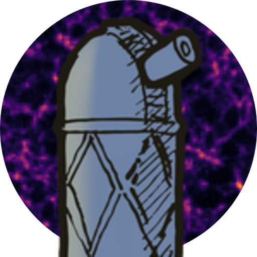

# Large-Scale Cursor
An interactive simulator of the cosmic web: <https://hsimonfroy.github.io/lscursor/>

<div align="center">
    <picture>
        
    </picture>
</div>

Inspired by Chris North's [Planck CMB Simulator](https://chrisnorth.github.io/planckapps/Simulator/), but for galaxy surveys instead of the CMB.

Move the sliders to change the content of the Universe, and a 2D slice of the cosmic web updates in real time. A divider splits the map between your universe and a fixed "observation" generated from the same random seed. When your parameters match the observation, the seam vanishes. A side panel shows the power spectrum or the correlation function of both.


## Features
* Five parameters:

  | slider | symbol | effect |
  |---|---|---|
  | Ordinary matter | Ω_b | baryon suppression, BAO wiggle amplitude |
  | Dark matter | Ω_c | turnover scale k_eq, overall clumpiness |
  | Dark energy | Ω_Λ | set by Ω_b + Ω_c + Ω_Λ = 1 |
  | Redshift-space distortions | f | radial squashing of structures |
  | Galaxy bias | b₁ | how strongly galaxies trace matter |

* The observer sits in the bottom-left corner, so the slice is a light cone from z = 0 to z ≈ 0.73 at the far corner, and redshift-space distortions are radial.
* The side panel shows the power spectrum P(k) or the two-point correlation function ξ(s). Click the axis labels to switch between log and linear scales. In linear k P(k) the BAO wiggles are visible, and in s²ξ(s) the BAO peak near 105 Mpc/h.
* URL options:
  * `#power`, `#2pcf` open the side panel on that statistic, `#none` closes it.
  * `?norm=sigma8` holds σ₈ fixed instead of the primordial amplitude A_s (see below).
* Works on desktop and mobile. Requires WebGL2 with float render targets (`EXT_color_buffer_float`).


## Simulation
* Zel'dovich (1LPT) galaxy field in a periodic 1280 Mpc/h box, on a 256×256×64 grid (5 Mpc/h cells, k_Nyquist = 0.63 h/Mpc), projected through an 8-cell (40 Mpc/h) slab.
* Linear power spectrum from the Eisenstein & Hu (1998) transfer function, h fixed to Planck 2018.
* By default A_s is fixed and σ₈ follows from the other parameters, so removing dark matter really does remove structure (σ₈ ≈ 0.08 at Ω_c = 0). With `?norm=sigma8`, σ₈ is fixed at 0.8102 and the Ω sliders only change the shape of P(k); far from the fiducial cosmology this implies an unphysical A_s (×116 at Ω_c = 0). Both modes agree at the fiducial cosmology, so the observation is the same.
* The side panel plots linear theory, not a measurement of the map: the Kaiser monopole (b₁² + 2b₁f/3 + f²/5) P_lin(k) at z = 0, and its Hankel transform for ξ(s) (`src/cosmo/xi.js`). A 1280 Mpc/h box has too few large-scale modes for the BAO to survive cosmic variance in a measured spectrum. The map's own P(k) can still be computed from the console with `window.__measurePk()`.
* The colour scale is fixed to the observation, between its 10⁻⁴ and 1 − 10⁻⁴ quantiles, with an `asinh(2t)/asinh(2)` stretch so that typical pixels are not lost in the dark end of the colour map. `dev/looks.html` compares other choices.


## Performance
No data is precomputed or shipped, and the parameters are continuous. This relies on two facts:
* b₁ and f only act at render time. In 1LPT the velocity is parallel to the displacement, so f rescales the radial component and b₁ is a per-particle weight. Both cost one draw call over ~500k points.
* Ω_b and Ω_c only enter through the 1D function √P(k), applied to a fixed white noise field (the analogue of the Planck simulator's √C_ℓ filter).

A change of Ω is therefore one synthesis pass in Fourier space followed by one inverse FFT. Only the 8 layers of the slab are needed, so the z-transform is evaluated directly at those layers during synthesis, and the x/y FFTs run on a volume 8× smaller. This is exact, matching the full 3D FFT to 1.2e-5.

On an Intel RPL-U integrated GPU:

| action | time |
|---|---|
| change b₁, f, or move the divider | ~4 ms |
| change Ω | 25–47 ms |

Most of the remaining cost is split between synthesis and 2D FFT. Rendering all output layers at once (multiple render targets) and a radix-4 FFT would be the next improvements.


## Validation
Physics modules are compared against [`jax_cosmo`](https://github.com/DifferentiableUniverseInitiative/jax_cosmo) and `montecosmo`:

| check | reference | result |
|---|---|---|
| `eh98.js` transfer function | `jax_cosmo.transfer.Eisenstein_Hu` | 1.2e-13 |
| `background.js` D(a), f(a) | `montecosmo.nbody.a2g`, `a2f` | 6.3e-7 |
| `background.js` χ(a) | `montecosmo.nbody.a2chi` | 1.2e-9 |
| `power.js` P_lin | `jax_cosmo.power.linear_matter_power` | 1.0e-4 |
| GPU FFT vs naive DFT | in-browser, 8×8×4 | 2.7e-7 |
| GPU FFT round trip | in-browser, 256×256×64 | 7.4e-6 |

Field variances agree with the analytic sum over modes within realisation scatter, the painted field conserves mass, and RSD are isotropic at f = 0.


## Limitations
* Large scales are under-clustered. The slab is selected on initial (Lagrangian) positions and the z-displacement is not computed, so matter flowing through the top and bottom of the slab is missing. The projected matter power is 5–7× too low at k ≲ 0.01 h/Mpc and 2× too low at 0.05 h/Mpc. Carrying Ψ_z and selecting particles on their final positions would fix this.
* 1LPT only: particles cross each other after shell crossing, so the densest knots are too diffuse.
* Linear physics: no massive neutrinos, linear Lagrangian bias, Kaiser RSD in the plotted statistics.


## Development
No build step and no dependencies. Serve the directory and open `index.html`:
```
python3 dev/serve.py            # http://127.0.0.1:8777/
```
`dev/serve.py` is `python3 -m http.server` with a `Cache-Control: no-cache` header, so that browsers do not serve stale ES modules after an edit.

Test pages in `dev/`:
* `cosmo.html`: P(k), T(k), D(z), f(z)
* `fft.html`: GPU FFT against a reference DFT, and timings
* `fields.html`: synthesised δ_L and Ψ against analytic variances
* `slab.html`: slab pipeline against the full 3D reference
* `energybar.html`, `looks.html`, `stats.html`: layout, tone curve and colour map variants
* `logo.html`: icon artwork

Headless scripts (need `playwright-core` and Chrome at `/usr/bin/google-chrome`):
```
node dev/run-checks.mjs fields      # or fft, slab
node dev/bench.mjs                  # frame timings
node dev/viewports.mjs /tmp         # screenshots at desktop, laptop and phone sizes
node dev/hashcheck.mjs              # URL hash behaviour
node dev/makeicons.mjs              # regenerate assets/icon-*.png
```

GitHub Pages serves `main` from the repository root.


## Licence
MIT, see [LICENSE](LICENSE). The title font `assets/fonts/Z003-MediumItalic.otf` (URW Z003, from urw-base35) is AGPL-3.0 with a font exception.
